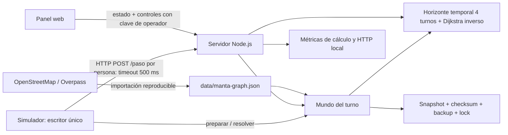
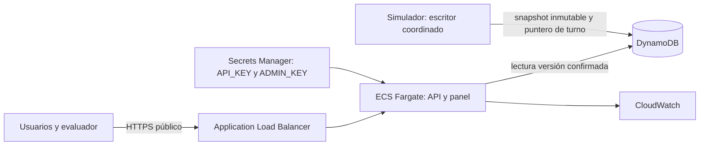

# Arquitectura de Manta Rescue

## Implementada y probada localmente

Servidor, simulador y planificador viven en un mismo proceso. El puerto escucha en localhost por defecto. Los archivos estáticos y health son públicos; estado y paso requieren API key; control requiere clave de operador. Las claves se inyectan por entorno y no se persisten en el snapshot.

El simulador prepara el turno y lo guarda antes de pedir decisiones; todas usan ese estado estable. Al terminar los timeouts aplica una única resolución y guarda el turno confirmado. Recuperar una fase `deciding` repite decisiones idempotentes, no el movimiento de zombis. La conexión HTTP y su timeout están implementados aunque el cliente esté en el mismo host.

## Objetivo AWS, todavía pendiente

No existe aún adaptador DynamoDB. El volumen Docker local no se convierte automáticamente en almacenamiento persistente Fargate. No activar varias réplicas del servidor actual: cada una tendría un mundo distinto. Exportar esta arquitectura a PNG/SVG al cerrar el diseño para cumplir el entregable del concurso.
