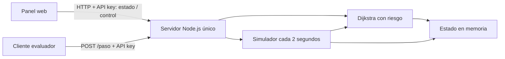
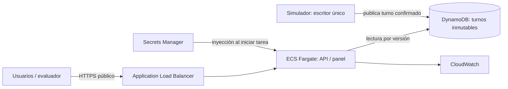

# Arquitectura

## Implementada localmente

## Objetivo AWS, pendiente de implementar

ECS no debe ser accesible directamente desde Internet. Un turno debe publicarse completo antes de estar disponible para decisiones. Las rutas y las métricas deben identificar la versión del mundo. Exportar el diagrama final a PNG/SVG para cumplir el entregable.
